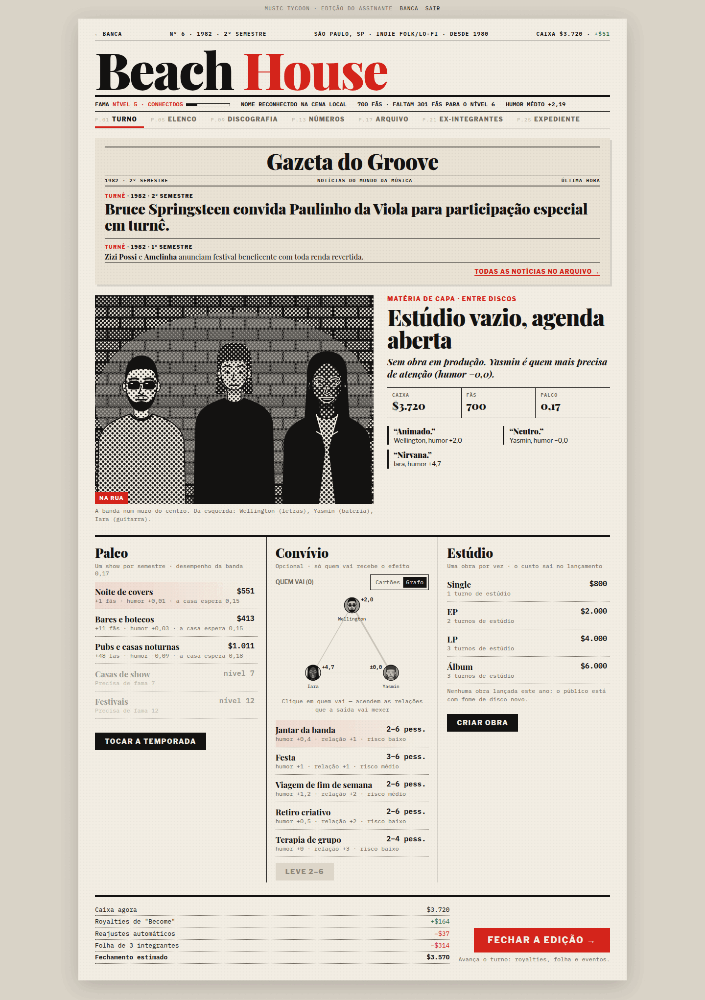
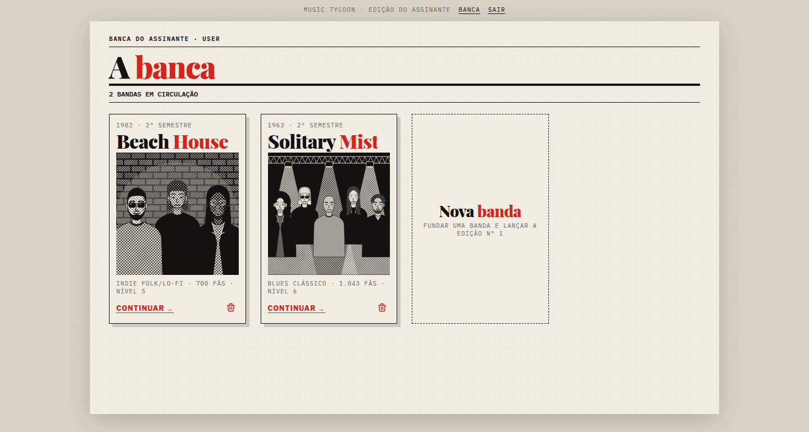
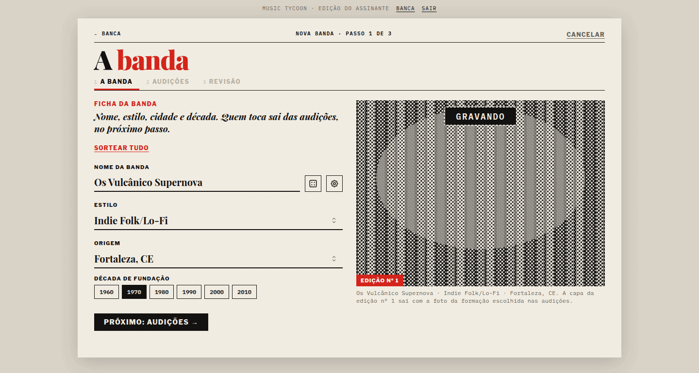
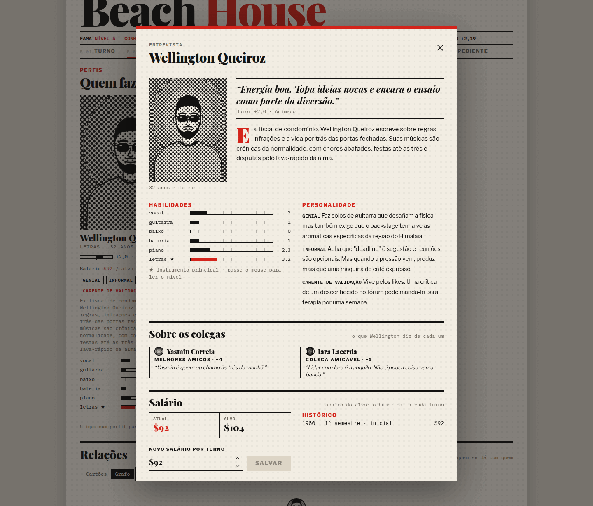
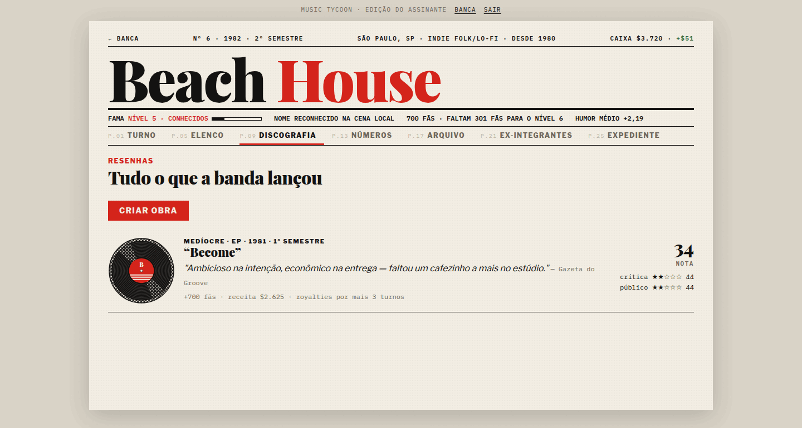
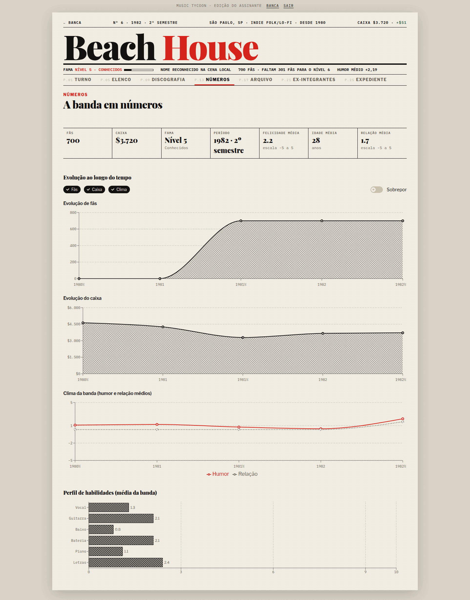

# game-music — frontend

Frontend do **Music Tycoon**, um jogo de gerenciamento de banda por turnos. Você
funda uma banda, escala os integrantes nas audições e, a cada semestre, decide
onde tocar, o que fazer com o elenco e o que gravar. O jogo cobra salários,
lança os discos para a crítica e o público e publica as notícias da cena.

A interface imita uma revista de música impressa: cada banda é uma publicação,
cada turno é uma edição e os retratos são desenhados em retícula.

É uma SPA em React + TypeScript que consome a API REST do
[`game-music-backend`](https://github.com/NycolasFelipe/game-music-backend), onde vivem as regras do jogo.



## Telas

### A banca
A lista de bandas do jogador, cada uma com a foto da formação.



### Nova banda
Ficha da banda (nome, estilo, cidade e década), audições e revisão. "Sortear
tudo" preenche a ficha de uma vez.



### Turno
O painel do semestre. No topo, a **Gazeta do Groove** traz as notícias do ano
corrente, com os discos da banda como manchete. Embaixo ficam a matéria de capa,
com a foto e o humor de cada integrante, e as três decisões do semestre: o show
(Palco), a atividade em grupo (Convívio) e a próxima obra (Estúdio). O rodapé
prevê o caixa antes de fechar a edição.

### Entrevista
Clicar num integrante do Elenco abre a entrevista: a fala que vem do humor, a
biografia, as habilidades, a personalidade, o que ele diz de cada colega e o
salário, com ajuste e histórico.



### Discografia
Cada lançamento com a nota da crítica e do público, a resenha e o que rendeu.



### Números
Fãs, caixa, clima da banda e perfil de habilidades ao longo do tempo, em
gráficos de retícula.



## Stack

| Camada | Escolha |
|---|---|
| Build e servidor de desenvolvimento | Vite |
| Linguagem | TypeScript (strict) |
| Componentes | Mantine |
| Estado de servidor | TanStack Query |
| Estado de interface | Zustand |
| Rotas | React Router |
| Gráficos | Recharts |
| Testes | Vitest e React Testing Library |
| Lint | ESLint (typescript-eslint) |

## Como rodar

O frontend precisa da API no ar. No `game-music-backend`:

```bash
cp .env.example .env
docker compose up -d --build    # PostgreSQL na 5432 e API na 3000
npm install
npm run db:migration:run
npm run db:seed                 # cria o usuário de desenvolvimento (user / user)
```

Depois, neste repositório:

```bash
cp .env.example .env    # VITE_API_URL aponta para a API (padrão: http://localhost:3000)
npm install
npm run dev             # http://localhost:5173
```

Em desenvolvimento, a página da banda ganha a aba **Oficina (dev)**, com atalhos
para testar o jogo. Ela não aparece no build de produção.

## Scripts

| Comando | O que faz |
|---|---|
| `npm run dev` | Servidor de desenvolvimento do Vite |
| `npm run build` | Checagem de tipos e build de produção em `dist/` |
| `npm run preview` | Serve o build de produção |
| `npm run typecheck` | `tsc --noEmit` |
| `npm run lint` | ESLint |
| `npm test` | Testes com Vitest |
| `npm run check` | Tipos, lint e testes, nessa ordem |

Rode `npm run check` antes de abrir um commit.

## Organização

O código é organizado por domínio em `src/features/` (bandas, shows,
atividades, lançamentos, eventos, decisões, turnos…), espelhando os módulos do
backend. As páginas em `src/pages/`
compõem essas features, e a interface compartilhada da revista fica em
`src/components/`. As regras de arquitetura e de estilo estão no
[AGENTS.md](AGENTS.md).

As decisões de arquitetura e de design ficam em [docs/adr/](docs/adr/README.md).
